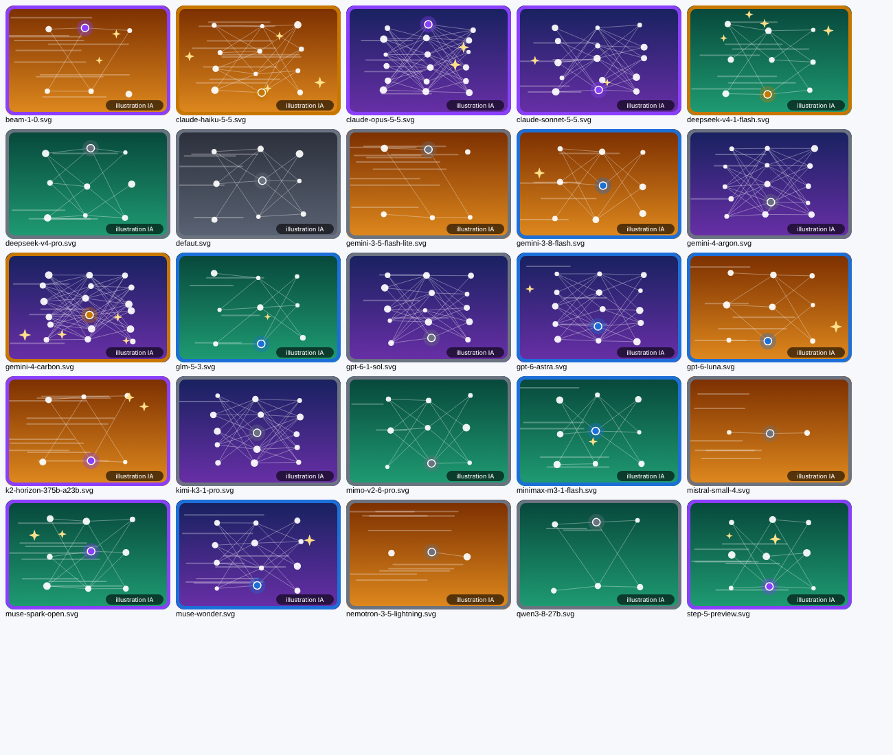

# LLM Cards - jeu de cartes à collectionner de modèles de langage (Flask + SQLite)

Application web de jeu de cartes à collectionner. **Chaque carte est un vrai modèle de langage** (Gemini 4 Carbon, Claude Opus 5.5, GPT-6 Astra, DeepSeek V4.1 Flash...), noté d'après ses résultats aux benchmarks récents : sa **puissance** (indice d'intelligence) et sa **vitesse** (jetons par seconde). **Une carte rare est un bon modèle dans sa catégorie.** Les joueurs créent un compte, ouvrent des boosters, complètent leur collection et se défient pour grimper dans le classement.



*Illustrations générées par IA (technique hors programme, voir plus bas).*

## Installation

Prérequis : Python 3.9 ou plus récent.

```bash
python -m venv venv
source venv/bin/activate          # Windows : venv\Scripts\activate
pip install -r requirements.txt   # installe Flask
```

## Utilisation

```bash
python creer_bdd.py   # crée cartes.db : tables, 24 cartes, 3 comptes de démonstration
python app.py         # lance le serveur
```

Ouvrir ensuite <http://127.0.0.1:5000> dans un navigateur. Les fichiers `donnees.sql` et `static/cartes/*.svg` sont déjà fournis.

> `python creer_bdd.py` **efface** la base existante : à ne lancer qu'une fois, ou pour repartir de zéro.

Comptes de démonstration :

| Pseudo | Mot de passe | Rôle |
|---|---|---|
| admin | admin1234 | administrateur (peut ajouter des cartes) |
| alice | alice1234 | joueuse avec 5 cartes |
| bob | bob12345 | joueur avec 6 cartes |

Tu peux aussi créer ton propre compte : tu reçois 100 pièces et la carte *DeepSeek V4 Pro*.

## Tests

```bash
python tests.py        # ou : pytest tests.py
```

Les tests utilisent une base temporaire : ils ne modifient jamais `cartes.db`. Ils couvrent le calcul des caractéristiques à partir des benchmarks, la rareté relative à la catégorie, la cohérence de `donnees.sql` avec `modeles.csv`, la présence et la mention « IA » de chaque illustration, le schéma et les contraintes SQL (clés étrangères, CHECK, UNIQUE), les comptes, le catalogue, les boosters, les combats, le classement, la protection contre les injections SQL et toutes les routes Flask (formulaires, session, accès réservé).

## Les cartes et les benchmarks

- **Puissance** (0 à 10) = indice d'intelligence (Artificial Analysis, v5.0) / 6. **Vitesse** (0 à 10) = jetons par seconde / 25.
- **Score global** = 7 x puissance + 3 x vitesse : la puissance compte, mais pas sans la vitesse.
- **3 catégories** de 8 modèles : *Frontier* (propriétaires haut de gamme), *Poids ouverts*, *Compact* (légers et rapides).
- **Rareté** = rang du modèle **dans sa catégorie** : 1er Légendaire, 2e et 3e Épiques, 4e et 5e Rares, les autres Communs. Ainsi Claude Haiku 5.5, meilleur des Compacts, est Légendaire, alors que GPT-6.1 Sol, plus puissant mais dans la catégorie la plus disputée, est Commun.

Données relevées le 2 novembre 2026. Sources, précautions, tableau complet des 24 cartes et procédure de mise à jour : `docs/BENCHMARKS.md`.

## Règles du jeu

- **Booster** : 50 pièces pour 3 cartes tirées au hasard. Chances de tirage : Commune 60 %, Rare 25 %, Épique 12 %, Légendaire 3 %.
- **Combat** : tu choisis un adversaire et une de tes cartes ; l'adversaire défend avec une de ses cartes tirée au hasard. Chaque carte inflige `puissance x (15 - vitesse adverse)` dégâts : plus l'adversaire est rapide, plus il est difficile à toucher. Celle qui en inflige le plus gagne (égalité si les dégâts sont identiques).
- **Récompenses** : victoire = +20 pièces ; égalité = +5 pièces pour chacun.
- **Classement** : trié par nombre de victoires, puis par nombre de combats joués (moins = mieux).


## Organisation du projet

```
projet_llm_cards/
├── app.py                   routes Flask (une fonction par page)
├── modele.py                requêtes SQL + règles du jeu (sans Flask : testable seul)
├── modeles.csv              les 24 modèles et leurs benchmarks (relevé du 2 novembre 2026)
├── generer_donnees.py       modeles.csv -> donnees.sql (calcul des stats, rangs et raretés)
├── generer_illustrations.py [IA] génère les images SVG des cartes
├── creer_bdd.py             crée la base à partir de schema.sql et donnees.sql
├── schema.sql               CREATE TABLE (6 tables, clés et contraintes)
├── donnees.sql              raretés, catégories et 24 cartes (généré : ne pas modifier à la main)
├── tests.py                 batterie de tests (assert)
├── requirements.txt
├── templates/               pages HTML (Jinja) ; base.html = page mère
├── static/
│   ├── style.css            mise en forme
│   └── cartes/              25 illustrations SVG (24 cartes + image par défaut)
└── docs/
    ├── MCD_et_SR.md         MCD, schéma relationnel, requêtes clés
    ├── BENCHMARKS.md        sources, formules, tableau des 24 cartes, mise à jour
    ├── PRESENTATION.md      exemple de document de présentation
    ├── UTILISATION_IA.md    règles d'usage de l'IA, éléments hors programme, questions orales
    └── apercu_illustrations.png
```

La base peut aussi être construite avec un outil externe (DB Browser for SQLite...) en important `schema.sql` puis `donnees.sql`. Les comptes de démonstration sont alors à créer par l'application (inscription).

## Routes

| Route | Méthodes | Connexion | Rôle |
|---|---|---|---|
| `/` | GET | non | accueil et chiffres clés |
| `/cartes` | GET | non | catalogue avec illustrations, filtres rareté et catégorie dans l'URL |
| `/regles` | GET | non | explication des benchmarks, raretés, combat et booster |
| `/classement`, `/combats` | GET | non | classement, historique des combats |
| `/inscription`, `/connexion` | GET, POST | non | formulaires de compte |
| `/deconnexion` | GET | non | efface la session |
| `/profil` | GET, POST | oui | changer de pseudo ou de mot de passe |
| `/inventaire` | GET | oui | cartes possédées |
| `/booster` | GET, POST | oui | acheter un booster |
| `/combat` | GET, POST | oui | défier un joueur |
| `/admin/carte` | GET, POST | admin | ajouter un modèle au catalogue |


## Choix techniques et sécurité

- **Requêtes paramétrées** : toutes les valeurs passent par `?`, jamais par concaténation ou f-string. Les tests vérifient qu'un `' OR '1'='1` est inoffensif.
- **Mots de passe hachés** : la base ne contient que des empreintes (`generate_password_hash` de Werkzeug, installé avec Flask), jamais les mots de passe. C'est un élément hors programme, repéré `[IA]` (voir plus bas).
- **Clés étrangères** : SQLite ne les vérifie que si `PRAGMA foreign_keys = ON` est exécuté à chaque connexion (fait dans `modele.connexion()`).
- **Transactions** : l'achat d'un booster, la création d'un joueur (joueur + carte de départ) et un combat (enregistrement + récompenses) utilisent une seule connexion et un seul `commit()` : tout est enregistré, ou rien.
- **Mesures figées** : les benchmarks changent chaque mois, mais `puissance` et `vitesse` sont enregistrées dans la table `Carte` : une carte déjà possédée ne change pas.
- **Session** : `session["id_joueur"]` (cookie signé avec `app.secret_key`). Les pages réservées renvoient vers `/connexion` si personne n'est connecté.
- **Séparation des rôles** : `app.py` ne contient aucune requête SQL ; `modele.py` ne connaît pas Flask.

## Utilisation de l'IA (hors programme uniquement)

J'ai utilisé une IA (Claude) **uniquement pour des éléments hors programme** dont on ne trouvais pas de solution tout seul.

| Élément | Ce que j'en ai compris |
|---|---|
| **Illustrations des cartes** | Elles sont **générées par IA** (fichiers SVG fabriqués par `generer_illustrations.py`). Le fond indique la catégorie, le cadre et les étoiles la rareté, le nombre de neurones la puissance, les traits la vitesse. La mention « illustration IA » figure dans chaque image et dans le pied de page. |
| Hachage des mots de passe | La base stocke une empreinte à sens unique (avec un sel aléatoire) ; à la connexion on recalcule l'empreinte et on la compare. |
| Session Flask | Un cookie signé garde l'identifiant du joueur d'une requête à l'autre, car HTTP n'a pas de mémoire. |
| `PRAGMA foreign_keys` | SQLite ne vérifie pas les clés étrangères par défaut. J'ai retiré la ligne et vu le test `test_cles_etrangeres_actives` échouer. |

L'IA m'a aussi aidé à rechercher les benchmarks ; je les ai vérifiés sur plusieurs sites (`docs/BENCHMARKS.md`).

Tout le rest ( surtout les compétences ) a été fait 100% par nous deux à la sueur de notre front.

