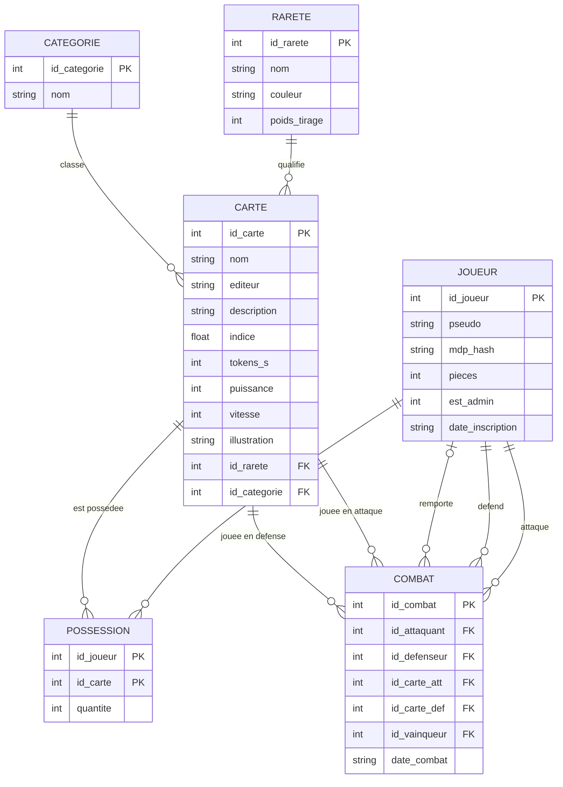

# MCD et schéma relationnel - LLM Cards

## 1. Règles de gestion

1. Un **joueur** a un pseudo unique (majuscules/minuscules ignorées), un mot de passe (stocké haché), un solde de pièces et, éventuellement, le statut d'administrateur.
2. Chaque **carte** représente un modèle de langage : un éditeur, deux benchmarks (indice d'intelligence et vitesse en jetons par seconde), une puissance et une vitesse de jeu (entiers de 0 à 10) calculées à partir d'eux, une illustration, **une seule rareté** et **une seule catégorie** (Frontier, Poids ouverts ou Compact). La rareté mesure le rang du modèle dans sa catégorie.
3. Un joueur peut posséder **0 à n cartes différentes**, et un **nombre d'exemplaires** (au moins 1) de chacune. Une même carte peut être possédée par plusieurs joueurs.
4. Un **combat** oppose **deux joueurs différents** : l'attaquant et le défenseur. Chacun y engage **une** carte.
5. Un combat a **au plus un vainqueur** (l'un des deux joueurs). S'il n'y en a pas, c'est une égalité.

## 2. MCD (modèle conceptuel de données, Merise)

**Entités et attributs** (identifiant souligné dans un schéma papier ; noté ici en gras)

| Entité | Attributs |
|---|---|
| JOUEUR | **id_joueur**, pseudo, mdp_hash, pieces, est_admin, date_inscription |
| RARETE | **id_rarete**, nom, couleur, poids_tirage |
| CATEGORIE | **id_categorie**, nom |
| CARTE | **id_carte**, nom, editeur, description, indice, tokens_s, puissance, vitesse, illustration |
| COMBAT | **id_combat**, date_combat |

**Associations et cardinalités**

| Association | Entité A (card.) | Entité B (card.) | Attribut porté |
|---|---|---|---|
| POSSÉDER | JOUEUR (0,n) | CARTE (0,n) | quantite |
| QUALIFIER | RARETE (0,n) | CARTE (1,1) | |
| CLASSER | CATEGORIE (0,n) | CARTE (1,1) | |
| ATTAQUER | JOUEUR (0,n) | COMBAT (1,1) | |
| DÉFENDRE | JOUEUR (0,n) | COMBAT (1,1) | |
| REMPORTER | JOUEUR (0,n) | COMBAT (0,1) | |
| JOUER_ATT | CARTE (0,n) | COMBAT (1,1) | |
| JOUER_DEF | CARTE (0,n) | COMBAT (1,1) | |

Lecture d'une ligne : « un joueur attaque 0 à n combats ; un combat est lancé par exactement 1 joueur ».
`REMPORTER (0,1)` côté COMBAT : un combat a au plus un vainqueur (0 = égalité).

**Diagramme** (notation « pattes de corbeau » ; à coller sur <https://mermaid.live> pour l'exporter en image).
`POSSESSION` est ici dessinée comme une table, car c'est ce que devient l'association POSSÉDER (0,n)-(0,n) au passage au schéma relationnel.



## 3. Passage du MCD au schéma relationnel

- Chaque **entité** devient une **table** dont la clé primaire est son identifiant.
- Une association **(x,n)-(1,1)** (QUALIFIER, CLASSER, ATTAQUER, DÉFENDRE, JOUER_ATT, JOUER_DEF) disparaît : l'identifiant du côté « n » est ajouté **comme clé étrangère** dans la table du côté « 1,1 ».
- Une association **(0,n)-(0,n)** (POSSÉDER) devient une **table** dont la clé primaire est composée des deux identifiants (qui sont aussi des clés étrangères) ; l'attribut de l'association (`quantite`) devient une colonne.
- Une association **(x,n)-(0,1)** (REMPORTER) devient une clé étrangère **pouvant valoir NULL** (`id_vainqueur`).

## 4. Schéma relationnel

Convention : clé primaire en **gras**, clé étrangère précédée de `#`.

- Joueur (**id_joueur**, pseudo, mdp_hash, pieces, est_admin, date_inscription)
- Rarete (**id_rarete**, nom, couleur, poids_tirage)
- Categorie (**id_categorie**, nom)
- Carte (**id_carte**, nom, editeur, description, indice, tokens_s, puissance, vitesse, illustration, #id_rarete, #id_categorie)
- Possession (**#id_joueur**, **#id_carte**, quantite)
- Combat (**id_combat**, #id_attaquant, #id_defenseur, #id_carte_att, #id_carte_def, #id_vainqueur, date_combat)

Clés étrangères :

| Colonne | Référence |
|---|---|
| Carte.id_rarete | Rarete.id_rarete |
| Carte.id_categorie | Categorie.id_categorie |
| Possession.id_joueur | Joueur.id_joueur |
| Possession.id_carte | Carte.id_carte |
| Combat.id_attaquant, Combat.id_defenseur, Combat.id_vainqueur | Joueur.id_joueur |
| Combat.id_carte_att, Combat.id_carte_def | Carte.id_carte |

Contraintes d'intégrité (voir `schema.sql`) : `pseudo` et `Carte.nom` uniques ; `pieces >= 0` ; `indice >= 0` ; `tokens_s > 0` ; `puissance` et `vitesse` entre 0 et 10 ; `quantite >= 1` ; `id_attaquant <> id_defenseur` ; `id_vainqueur` peut être NULL (égalité).
Les tables **sans clé étrangère** sont `Joueur`, `Rarete` et `Categorie` (niveau 3) ; les tables **avec clés étrangères** sont `Carte`, `Possession` et `Combat` (niveau 5).

**Choix de conception.** `indice` et `tokens_s` (mesures brutes) et `puissance` et `vitesse` (valeurs de jeu, calculées à partir d'elles) coexistent volontairement : les benchmarks changent chaque mois, mais une carte déjà possédée ne doit pas changer. On garde donc un instantané des mesures et les valeurs de jeu qui en découlent. De même, la rareté est enregistrée (clé étrangère) au lieu d'être recalculée à chaque affichage. Voir `docs/BENCHMARKS.md`.

## 5. Requêtes SQL clés de l'application

```sql
INSERT INTO Joueur (pseudo, mdp_hash, est_admin) VALUES (?, ?, ?);
UPDATE Joueur SET pseudo = ? WHERE id_joueur = ?;

SELECT c.nom, c.editeur, c.puissance, c.vitesse, r.nom AS rarete, cat.nom AS categorie, p.quantite
FROM Possession AS p
JOIN Carte AS c      ON p.id_carte = c.id_carte
JOIN Rarete AS r     ON c.id_rarete = r.id_rarete
JOIN Categorie AS cat ON c.id_categorie = cat.id_categorie
WHERE p.id_joueur = ?
ORDER BY r.id_rarete DESC, c.nom;

SELECT COUNT(*) FROM Combat WHERE id_vainqueur = ?;          -- victoires d'un joueur (classement)

INSERT INTO Carte (nom, editeur, description, indice, tokens_s, puissance, vitesse, id_rarete, id_categorie)
VALUES (?, ?, ?, ?, ?, ?, ?, ?, ?);
INSERT INTO Combat (id_attaquant, id_defenseur, id_carte_att, id_carte_def, id_vainqueur) VALUES (?, ?, ?, ?, ?);
UPDATE Possession SET quantite = quantite + 1 WHERE id_joueur = ? AND id_carte = ?;
```
